

  

<h1 align="center">Chati.AI</h1>

  <b>Un agente de IA con cara, voz, teléfono y manos. En tu PC.</b>

  No es un chatbot con una foto al lado: es un agente de verdad que <b>te habla, gesticula y se emociona</b>, 
  tiene su propia personalidad y <b>hace el trabajo</b>: navega, programa, maneja tus archivos y usa herramientas. 
  Puede tener <b>su propio WhatsApp</b> y cogerte las videollamadas. Con modelos en tu PC o en la nube.

  
  &nbsp;
  
  &nbsp;
  
  &nbsp;
  
  &nbsp;
  

  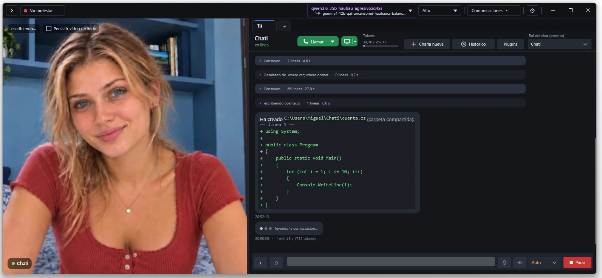

<i>Te mira, te contesta, se ríe y, si te pasas, se enfada. Y mientras charláis, te hace los recados.</i>

---

## Chati.AI en acción

  <a href="https://youtu.be/vuDk57mIgTc">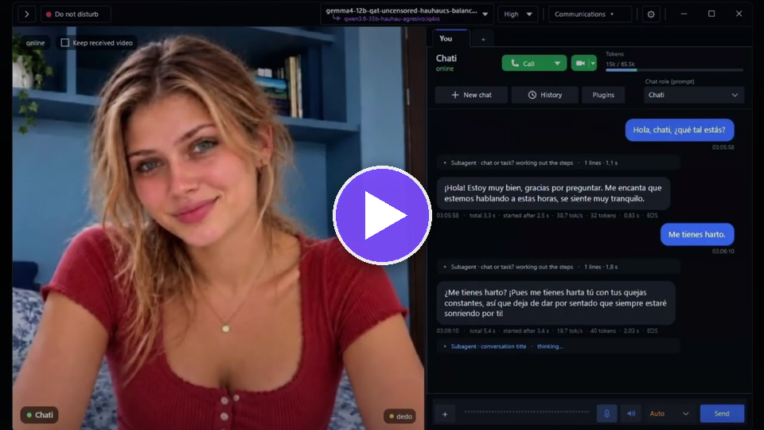</a> 
  <b>🎭 Cara, voz y emociones</b> 
  Lena charlando contigo y enseñando lo que siente.

<table>
  <tr>
    <td width="50%" align="center">
      <a href="https://youtu.be/gvGvxeBvuuc">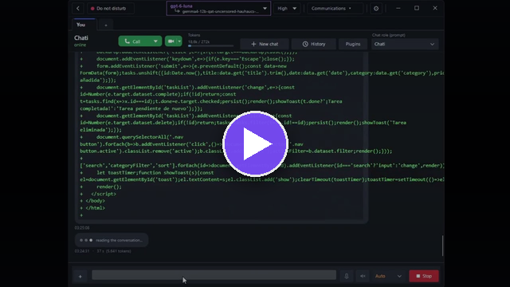</a> 
      <b>🧰 Un agente que trabaja por ti</b> 
      Se encarga de tareas de verdad en tu ordenador.
    </td>
    <td width="50%" align="center">
      <a href="https://youtu.be/MG_ookbJMFQ">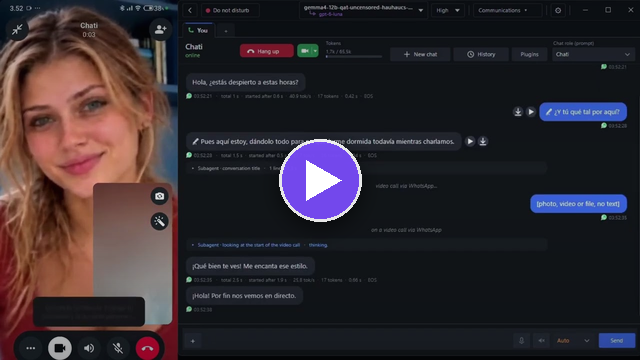</a> 
      <b>📱 Videollamadas por WhatsApp</b> 
      La llamas desde el móvil y te lo coge, con su cara y su voz.
    </td>
  </tr>
</table>

---

## En 30 segundos

| | |
|---|---|
| 🧰 **Es un agente** | Navega, lee y escribe archivos, ejecuta comandos, hace planes, usa habilidades y servidores MCP. Con tarjetas de permiso o en modo automático. |
| 🎭 **Tiene cara** | Vídeo real encadenado por emociones: sonríe, se sorprende, te guiña, se enfada. Varios avatares, masculinos y femeninos, y pronto más, algunos sin censura. |
| 🎙️ **Voz en tiempo real** | Habla y te escucha en tu PC, sin internet. La puedes interrumpir hablando. |
| 👀 **Te ve** | Compártele la webcam o la pantalla y te comenta lo que ve. |
| 📱 **Tiene teléfono** | Su propia cuenta de WhatsApp, su número con SIM, videollamadas por Meet, Telegram y correo. |
| 🌍 **Multilingüe** | La aplicación en 8 idiomas, y te contesta en el tuyo. |
| 🖥️ **Local o nube** | Ollama, LM Studio, llama.cpp, tu cuenta de ChatGPT, Gemini, Groq, Cerebras, Mistral, OpenRouter… |
| 🔁 **Gratis, todo el día** | Varias cuentas gratuitas: cuando una se agota, salta sola a la siguiente. |
| 🔀 **Router de modelos** | Un modelo gratuito para charlar y otro, de pago o gratuito, para programar. Cambia sola según lo que pidas. |
| 🔓 **Sin censura añadida** | Lo que dice depende solo del modelo y la personalidad que elijas. No hay nadie en medio. |

<table>
  <tr>
    <td width="50%" align="center">
      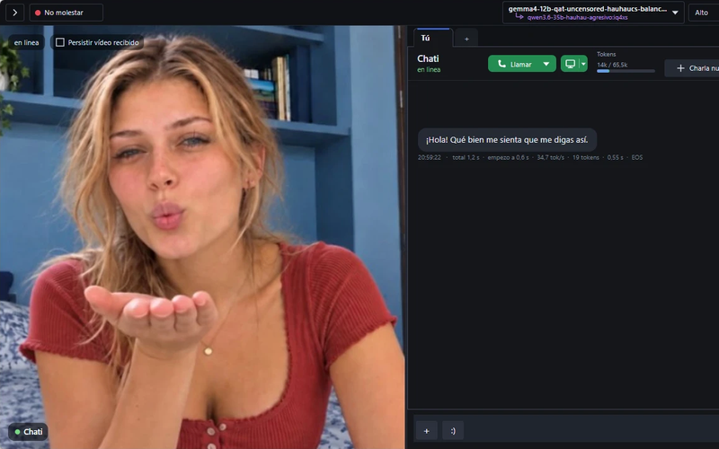 
      <b>Reacciona a lo que dice</b> 
      Clips de vídeo por emoción, con fundidos que no se notan. Si llevas rato callado, te habla ella.
    </td>
    <td width="50%" align="center">
      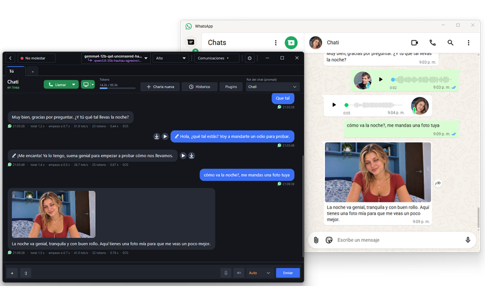 
      <b>Te coge el WhatsApp</b> 
      Con su propio número. Chatea, manda fotos y notas de voz y coge llamadas y videollamadas.
    </td>
  </tr>
  <tr>
    <td align="center">
      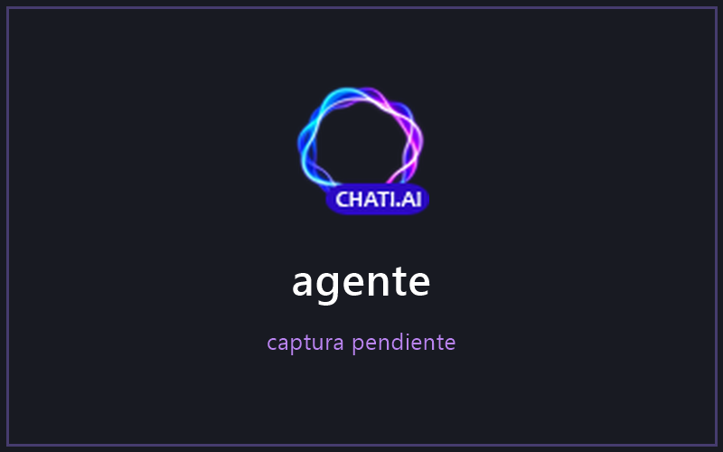 
      <b>Hace cosas por ti</b> 
      Busca en internet con un navegador real, edita archivos, lanza comandos y te enseña una tarjeta antes de tocar nada.
    </td>
    <td align="center">
      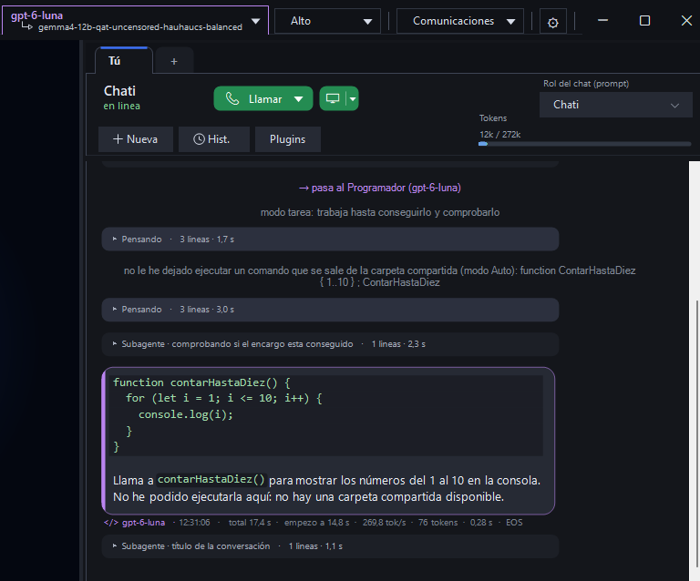 
      <b>Un router que elige el modelo</b> 
      Uno barato o gratuito para charlar y otro potente para programar. Entra solo cuando toca código.
    </td>
  </tr>
  <tr>
    <td align="center">
      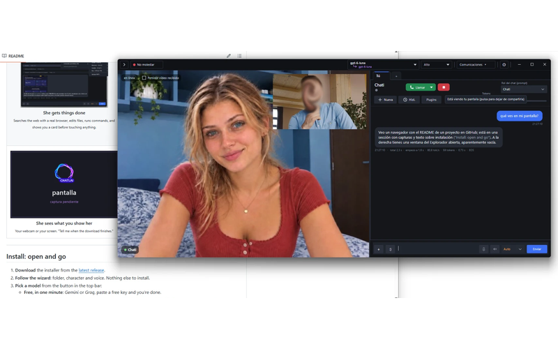 
      <b>Ve lo que le enseñas</b> 
      Tu webcam o tu pantalla. «Avísame cuando acabe la descarga.»
    </td>
    <td align="center">
      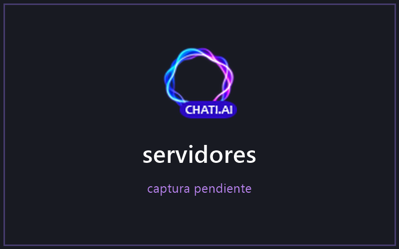 
      <b>Tus modelos, tus cuentas</b> 
      Cambia de modelo sin perder la charla. Varias cuentas por proveedor, con salto automático.
    </td>
  </tr>
  <tr>
    <td colspan="2" align="center">
      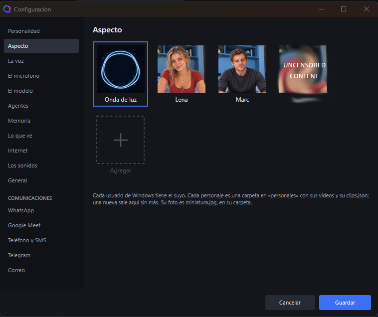 
      <b>Elige con quién hablas</b> 
      Lena, Marc o la onda de luz, y pronto más. Cada personaje es una carpeta: añade los tuyos.
    </td>
  </tr>
</table>

---

## Instalar

| 🪟 Windows | 🐧 Linux | 🍎 macOS (Apple Silicon) |
|:-:|:-:|:-:|
| [**Chati.AI-win-x64.zip**](https://github.com/nombrote/chati.ai/releases/latest/download/Chati.AI-win-x64.zip) | [**Chati.AI-linux-x64.tar.gz**](https://github.com/nombrote/chati.ai/releases/latest/download/Chati.AI-linux-x64.tar.gz) | [**Chati.AI-osx-arm64.tar.gz**](https://github.com/nombrote/chati.ai/releases/latest/download/Chati.AI-osx-arm64.tar.gz) |
| Descomprímelo y abre `ChatiAI.exe` | `tar xzf Chati.AI-linux-x64.tar.gz` `./Chati.AI-linux-x64/ChatiAI` | `tar xzf Chati.AI-osx-arm64.tar.gz` `./Chati.AI-osx-arm64/ChatiAI` |

Todas las versiones están también en la [página de descargas](https://github.com/nombrote/chati.ai/releases/latest). La aplicación todavía no va firmada: si Windows muestra el aviso de SmartScreen, pulsa *Más información › Ejecutar de todas formas*; si macOS no la deja abrir, ejecuta una vez `xattr -dr com.apple.quarantine Chati.AI-osx-arm64`.

1. **Descarga** el archivo de tu sistema y ábrelo como pone arriba. No hay que instalar nada: todo lo
   que necesita va dentro.
2. **El asistente lo prepara todo** la primera vez que la abres:
   - **Idioma**: español, inglés, francés, alemán, portugués, ruso, polaco o chino.
   - **Su cerebro**:
     - *En tu ordenador*: mira la memoria de tu tarjeta gráfica y tu RAM y te recomienda el modelo
       más grande que cabe. Marca *Instalar y configurar automáticamente* y ella instala Ollama, baja
       el modelo y comprueba que contesta.
     - *En internet*: entra con tu cuenta de ChatGPT o pega la clave de un proveedor.
   - **Aspecto y voz**: Lena, Marc o la onda de luz, y una voz que puedes escuchar antes de elegir.
     Solo se baja la voz que eliges.
   - **Listo**: desde ahí puedes pasar directamente a conectar WhatsApp, Telegram y lo demás.
3. **Empieza a hablar.** Escribe `/help` en el chat para ver los comandos.

Puedes volver a abrir el asistente cuando quieras desde el menú. ¿Prefieres configurarlo a mano? Usa el
botón de modelos de la barra de arriba: claves gratuitas de *Gemini* o *Groq*, tu cuenta de ChatGPT, o
tu propio [Ollama](https://ollama.com), [LM Studio](https://lmstudio.ai) o llama.cpp, que encuentra sola.

> **Requisitos:** Windows 10 u 11 (64 bits), Linux (64 bits) o macOS con Apple Silicon (M1 o posterior). Para modelos locales, una tarjeta gráfica con 5 GB como mínimo (9 GB para el modelo de 12 B); los más pequeños también van en el procesador si tienes RAM de sobra. Con modelos en la nube vale cualquier PC.

---

## Todo lo que hace

<b>🎭 Cómo la ves</b>

 

- **Personajes en vídeo**: cada personaje es una carpeta con sus vídeos y sus cortes. Añade los
  tuyos y aparecen solos en *Configuración › Aspecto*.
- **Onda de luz**: un avatar abstracto y discreto, para cuando no quieres cara.
- **Varios avatares para elegir**: Lena, Marc y la onda de luz, y pronto más, incluidos algunos
  sin censura.
- **Dos humores**: contenta o enfadada. Si la ofendes, hasta sus gestos de reposo cambian, y le dura.
- **Editor de clips** integrado: marca dónde empieza y acaba cada gesto y etiquétalo. El modelo se
  entera solo de los gestos nuevos.
- **Modo compacto** (F11): pliega el vídeo y la deja como una ventanita de chat a un lado.
- Lanza cualquier gesto a mano: `/beso`, `/triste`, `/lengua`…

<b>👀 Lo que ve y lo que oye</b>

 

- **Tu webcam o tu pantalla**, compartidas con ella. Un borde verde te avisa de que está mirando.
- **Vigilar la pantalla**: «avísame cuando acabe de compilar».
- **Fotos y archivos**: arrastra imágenes, PDF, Word, Excel o CSV al chat.
- **Voz en tiempo real**: habla con voces neuronales (idioma, voz y velocidad a elegir) y te escucha
  mientras hablas. Todo en tu PC, sin internet y sin instalar nada: va integrado y funciona en el
  procesador o en la tarjeta gráfica, a elegir. Puedes interrumpirla hablando y mandar sin pulsar Enter.
- **Llamadas y videollamadas** de voz con ella, desde la propia ventana.

<b>📱 Sus propias cuentas: WhatsApp, teléfono, Meet, Telegram, correo</b>

 

No es un chat encerrado en una ventana: puede tener sus propias cuentas y hablar contigo como una
persona más.

- **WhatsApp completo**: vincúlale un número con un QR y tendrá su cuenta de WhatsApp de verdad.
  Chatea, manda fotos y notas de voz y **coge llamadas y videollamadas**, poniendo su cara y su voz.
- **Videollamadas por Google Meet**: entra con su propia cuenta de Google y conversa por vídeo en
  tiempo real: te ve, te oye y te contesta hablando.
- **Número de teléfono propio** (solo en Windows): con un **módem USB y una SIM**, lee los SMS y **coge las llamadas**
  a su número. Por seguridad, nunca envía SMS ni llama por su cuenta.
- **Telegram**: bot propio. Te manda texto, fotos, vídeos de sus gestos y notas de voz. Con el modo
  *Ausente* la llevas en el móvil, y las tarjetas de permiso te llegan ahí, con PIN para lo peligroso.
- **Correo**: lee tu correo y te lo resume. Para enviar, siempre te pregunta.
- **Contactos**: tú decides quién puede hablar con ella. Cada contacto tiene su pestaña y su propia
  Chati, con su historial y su memoria aparte y **sin acceso a tus herramientas**.

<b>🧰 El agente: herramientas, habilidades y MCP</b>

 

- **Internet** con un navegador real: buscar, leer páginas, hacer clic, rellenar, descargar. Las
  páginas largas las resume un subagente investigador para no llenar la memoria del modelo.
- **Archivos y comandos**: leer, escribir y editar archivos; ejecutar comandos (PowerShell en Windows,
  bash en Linux y macOS).
- **Planes**: para encargos largos hace un plan y lo va tachando paso a paso.
- **Habilidades (skills)**: impórtalas **desde GitHub** (`usuario/repositorio`), de un `.zip`, un `.md`
  o una carpeta. Valen las de Claude, Codex, Cursor y skills.sh. O pídele que te cree una nueva: trae
  una habilidad para crear habilidades.
- **Servidores MCP**: añade cualquier servidor por URL y enciende o apaga sus herramientas con un clic.
- **Router de modelos**: no hace falta pagar un modelo caro para todo. Pon uno gratuito o ligero
  para conversar y otro más potente, de pago o gratuito, para programar. Un router decide en cada
  mensaje: cuando lo que pides toca código pasa al programador sola, y vuelve cuando cambias de tema.
  Lo suyo sale en morado para saber quién habla. También a mano con `/programa` y `/chati`.
- **Recordatorios y tareas**: «avísame cada 30 minutos de beber agua», «mañana a las 9 dime…»,
  «cuéntame una historia seguido».

<b>🛡️ Tú decides qué puede hacer</b>

 

- **Manual**: antes de tocar algo te enseña una tarjeta con *Ejecutar / Permitir siempre / No*.
  Las tarjetas te llegan también al móvil por Telegram.
- **Auto**: hace lo que haga falta, pero **solo dentro de las carpetas que le compartes**. Fuera de
  ellas, tarjeta.
- Comandos peligrosos con PIN. El módem nunca envía ni llama. El correo nunca se manda sin preguntar.

<b>🖥️ Modelos: en tu PC o en la nube, y gratis</b>

 

| En tu PC (privado, sin internet) | En la nube |
|---|---|
| **Ollama**: el asistente te lo instala y te baja el modelo recomendado | **ChatGPT con tu cuenta**: la suscripción que ya pagas, sin API |
| **LM Studio** | **Gemini** (AI Studio, con capa gratuita) |
| **llama.cpp**: la app arranca el servidor sola con tus `.gguf`, incluidos los de visión | **Groq**, **Cerebras**, **Mistral**, **OpenRouter**, todos con modelos gratis |
| Cualquier servidor compatible con OpenAI | OpenAI API o cualquier otro compatible |

- **Cambio en caliente**: cambia de modelo sin perder la conversación. Favoritos con estrella.
- **Varias cuentas gratuitas, una detrás de otra**: mete varias claves o cuentas del mismo proveedor
  y ordénalas. Cuando una agota su cupo, lo detecta, salta a la siguiente, te lo dice en el chat y
  vuelve a la primera cuando se recupera. Juntando capas gratuitas tienes modelos grandes todo el día.
- **Esfuerzo de razonamiento** a elegir (no, auto, bajo, medio, alto) en los modelos que razonan.
- Ves en todo momento cuánta memoria lleva ocupada el modelo y a qué velocidad escribe. En el
  contador de tokens tienes el reparto del contexto y, con tu cuenta de ChatGPT, los límites de uso del plan.

  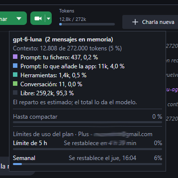

<b>🧠 Memoria y personalidad</b>

 

- **Memoria a largo plazo**: guarda lo importante y lo recuerda en otras conversaciones. Puedes ver,
  buscar y borrar lo que recuerda.
- **Contexto que no se acaba**: cuando la conversación se llena, la resume sola y sigue. También a mano con `/compact`.
- **Personalidades editables**: cambia de personaje desde la cabecera del chat o escribe la tuya en
  un `.md`. Hasta las instrucciones internas de sus subagentes se pueden reescribir.
- Histórico de conversaciones, varias pestañas, editar, borrar o repetir cualquier mensaje.
- Icono junto al reloj y arranque al iniciar sesión.

<b>⌨️ Comandos</b>

 

| Comando | Qué hace |
|---|---|
| `/help` | Ayuda y lista de comandos |
| `/new` | Charla nueva, eligiendo con quién |
| `/screen` | Le enseña tu pantalla (`/screen todas`, todas las pantallas) |
| `/programa` | Pasa al programador (`/programa arregla esto…` se lo manda directamente) |
| `/chati` | Vuelve ella |
| `/compact` | Resume la conversación para liberar memoria |
| `/beso`, `/triste`… | Lanza ese gesto en el vídeo |

---

## Privacidad y aviso

- Con un modelo local **nada sale de tu PC**: ni el texto, ni la voz, ni la imagen. Conversaciones,
  recuerdos, claves y ajustes se guardan en tu equipo.
- Con un proveedor en la nube, lo que escribes va a ese proveedor y se rige por sus condiciones.
- Chati.AI **no añade filtros de contenido**. Según el modelo y el personaje que elijas puede generar
  contenido para adultos: **solo para mayores de 18 años**. Eres responsable del uso que hagas de
  ella, de los modelos que cargues y de las cuentas que conectes.

---

## Apoya el proyecto

Chati.AI está hecha con cariño y demasiadas noches sin dormir. Si te alegra el día, puedes invitarme a un café.

  

